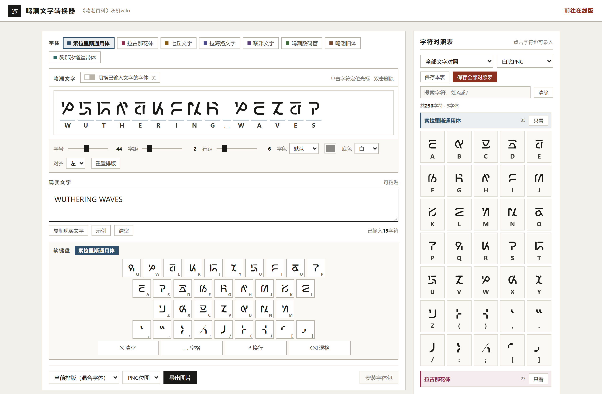
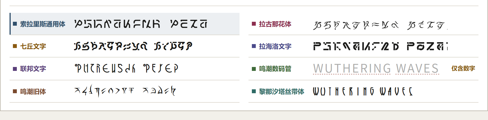

# 鸣潮文字转换器

将《鸣潮》中的各种文字与现实文字相互转换，并提供导出对照表等功能。

- 程序形式：HTML文件，无需联网；
- 使用方法：使用任一电脑浏览器打开；
- 下载地址：[Release](https://github.com/Fisher4124/WuWaFontConverter/releases/)或[百度网盘](https://pan.baidu.com/s/1G9LpZpISxWq9NJmYvm_aRg)；
- 在线项目：[《鸣潮百科》字体系统](https://wuwa.huijiwiki.com/p/830)。

## 基本功能

- 输入现实文字，实时显示对应的鸣潮字形，物理键盘与风格化软键盘联动，支持双向转换。
- 各款字体随时切换，支持逐字混排，也可以把已输入文字统一换成别的字体。
- 调整字号、字距、行距、字色、底色、对齐，所见即所得。
- 导出PNG位图或SVG矢量图，也可导出整套字符对照表。
- 附带字体包，可以安装至系统供Word、PS等软件选用（HTML文件不依赖任何tff文件即可运行，字体以base64形式内嵌，如有需求请自行点击【安装字体包】）。

## 界面布局

| 区域       | 位置       | 作用                                                         |
| ---------- | ---------- | ------------------------------------------------------------ |
| 字体       | 左栏最上   | 全部字体标签，点击切换当前字体                             |
| 鸣潮文字   | 左栏上     | 实时显示转换后的字形带，单击字符定位光标（双击删除） |
| 排版控件   | 字形带下方 | 字号、字距、行距、字色、底色、对齐、重置排版                 |
| 现实文字   | 左栏中     | 打字或粘贴原文                         |
| 操作按钮   | 输入框下方 | 复制现实文字、示例、清空，右侧显示已输入字符数               |
| 软键盘     | 左栏下     | 按当前字体生成的键位，头部显示当前字体名                     |
| 导出条     | 左栏最下   | 定义范围、格式、导出图片，以及靠右的「安装字体包」           |
| 字符对照表 | 右栏       | 筛查字形、点卡片录入、导出对照表                         |
| 全字体预览 | 两栏下方   | 一次看到各款字体的效果，点任一行切换字体键盘                     |

## 字体说明

| 字体           | 备注            | 分享来源                                   |
| -------------- | -------------------- | ------------------------------------------------ |
| 索拉里斯通用体 | 从今州就开始用的字体，含字母、数字、常用符号 | [言语关系](https://space.bilibili.com/379335206) |
| 拉古那花体     | 实际七丘人也在用，H有两种写法，由H和h分别映射 | [鸟居枫](https://space.bilibili.com/10599) |
| 七丘文字       | 没有出现J、Z两个字母 | [鸟居枫](https://space.bilibili.com/10599) |
| 拉海洛文字     | 包括希腊字母及数学符号 | [鸟居枫](https://space.bilibili.com/10599) |
| 联邦文字       | 新联邦及旧联邦所使用的文字 | [鸟居枫](https://space.bilibili.com/10599) |
| 鸣潮数码管     | 只有0~9十个数字，用于装饰以及前瞻直播倒计时 | [言语关系](https://space.bilibili.com/379335206) |
| 鸣潮旧体       | 公测后只用于拼写WutheringWaves作为装饰 | [言语关系](https://space.bilibili.com/379335206) |
| 黎那汐塔丝带体 | 大小写字母存在差异，用于[游戏外美化](https://wuwa.huijiwiki.com/wiki/%E5%88%86%E7%B1%BB:%E9%BB%8E%E9%82%A3%E6%B1%90%E5%A1%94%E9%A6%96%E6%9B%9D%E6%B5%B7%E6%8A%A5) | [言语关系](https://space.bilibili.com/379335206)|

<strong>欢迎关注<a href="https://wuwa.huijiwiki.com/wiki/首页">《鸣潮百科》灰机wiki</strong></a>
    
  
<strong>玩家共建的百科全书 · 索拉里斯的<a href="https://wuwa.huijiwiki.com/wiki/分类:杂谈" title="分类:杂谈">杂学</a>中心</strong>

